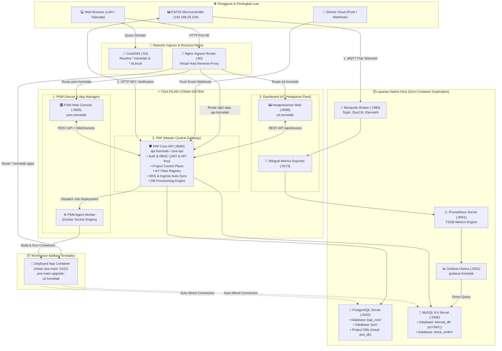
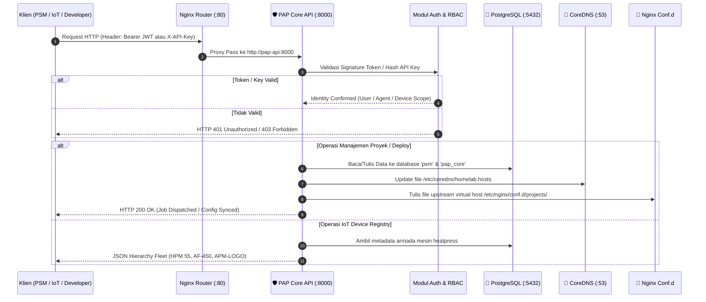
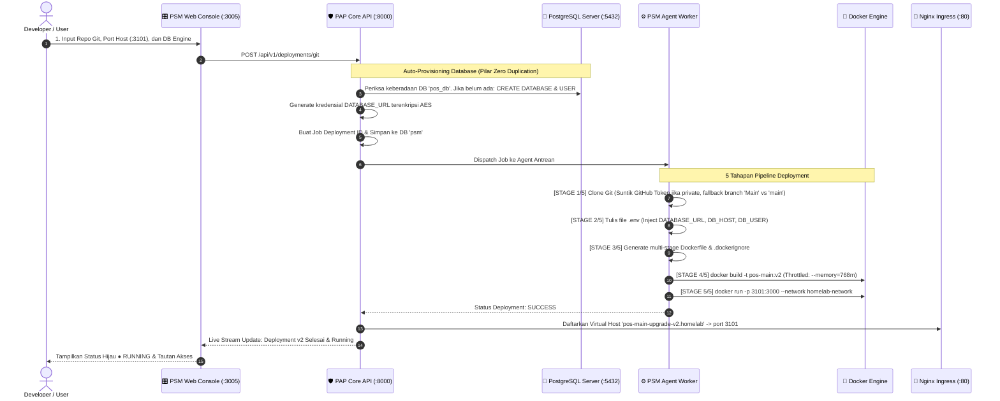
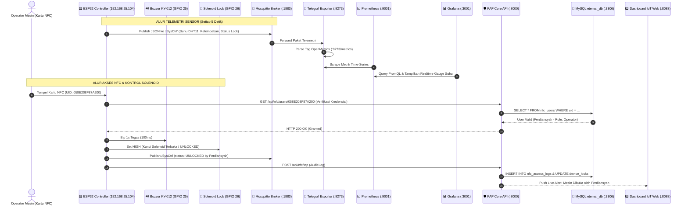
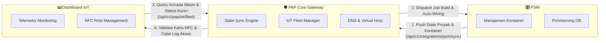

# 📘 Blueprint & Flow Sistem Homelab Server
## Fokus: Aliran Data & Cara Sistem Bekerja (PAP • PSM • Dashboard IoT)

Dokumen ini mendokumentasikan secara presisi dan mendalam bagaimana seluruh aliran data (**data flow**) dan mekanisme kerja sistem berjalan di dalam ekosistem **Homelab Server (`fa` - 192.168.25.101 / Tailscale 100.106.63.90)**, dengan fokus utama pada sinergi tiga pilar aplikasi:
1. **PAP (Personal API Platform — Port 8000)**: Master Central API Gateway, integrasi data, dan orkestrasi kontrol.
2. **PSM (Personal Server Manager — Web: 3005, Agent: In-Host)**: PaaS Deployment Engine, lifecycle container Docker, dan database auto-provisioning.
3. **Dashboard IoT (HeatpressHub — Web: 8088, Telegraf: 9273)**: Telemetri mesin heatpress, keamanan solenoid lock, dan akses NFC RFID.

---

## 📑 Daftar Isi
1. [Arsitektur Triad & Master Topology Map](#1-arsitektur-triad--master-topology-map)
2. [Flow 1: Sistem Kerja & Aliran Data PAP (Central Core Gateway)](#flow-1-sistem-kerja--aliran-data-pap-central-core-gateway)
3. [Flow 2: Sistem Kerja & Aliran Data PSM (PaaS Deployment Engine)](#flow-2-sistem-kerja--aliran-data-psm-paas-deployment-engine)
4. [Flow 3: Sistem Kerja & Aliran Data Dashboard IoT (Heatpress Fleet)](#flow-3-sistem-kerja--aliran-data-dashboard-iot-heatpress-fleet)
5. [Flow 4: Interkoneksi Sinergis (PAP ↔ PSM ↔ Dashboard IoT)](#flow-4-interkoneksi-sinergis-pap--psm--dashboard-iot)
6. [Matriks Aliran Data, Protokol & Port](#matriks-aliran-data-protokol--port)
7. [Audit Resource & Proteksi Memori Server (Anti-OOM)](#audit-resource--proteksi-memori-server-anti-oom)

---

## 1. Arsitektur Triad & Master Topology Map

Diagram berikut mengilustrasikan bagaimana data mengalir di antara **PAP**, **PSM**, **Dashboard IoT**, serta infrastruktur native host (Postgres, MySQL, MQTT, Prometheus, CoreDNS, Ingress Router):

---

## Flow 1: Sistem Kerja & Aliran Data PAP (Central Core Gateway)

**PAP (Personal API Platform)** adalah jantung komunikasi seluruh sistem. PAP bertindak sebagai **Single Source of Truth** untuk identitas, otorisasi, metadata proyek, dan registrasi perangkat.

### Cara PAP Bekerja:
1. **Modular Monolith Runtime**: Semua modul (*Auth, Projects, Deployments, IoT, DNS, DB Provisioning*) berada dalam satu proses FastAPI yang sangat hemat RAM (~384 MB).
2. **Dual-Layer Authentication**:
   - **Sesi Pengguna (Human-to-Machine)**: Menggunakan JWT Token dengan masa kedaluwarsa aman untuk akses PSM Web Console.
   - **Antar-Layanan (Machine-to-Machine)**: Menggunakan `X-API-Key` dengan hashing SHA-256 untuk PSM Agent, Telegraf, dan hardware ESP32.
3. **Automated Ingress & Local DNS Synchronization**:
   Setiap kali ada project baru yang di-deploy, PAP otomatis menyuntikkan entri domain baru ke file [dns/homelab.hosts](file:///d:/repository/homelab-server/dns/homelab.hosts) dan menghasilkan file konfigurasi reverse-proxy di [router/conf.d/projects/](file:///d:/repository/homelab-server/router/conf.d/projects/).

---

## Flow 2: Sistem Kerja & Aliran Data PSM (PaaS Deployment Engine)

**PSM (Personal Server Manager)** berfungsi sebagai platform-as-a-service (PaaS) lokal yang mengotomatisasi pembangunan dan peluncuran aplikasi dari Git repository atau file ZIP ke dalam container Docker.

### Cara PSM Bekerja:
1. **GitHub Full Access Integration**:
   - Mendukung Personal Access Token (PAT) tersimpan aman untuk meng-clone repositori privat (`x-access-token:{token}@github.com`).
   - **Smart Branch Resolution**: Jika branch diisi `main` namun di GitHub bernama `Main` (kapital), builder secara cerdas mencoba branch alternatif atau langsung meng-clone default HEAD branch tanpa membatalkan deployment.
2. **Auto-Wiring Database Host**:
   - PSM tidak menduplikasi container database. Sistem secara cerdas memanggil PostgreSQL (`:5432`) atau MySQL (`:3306`) host, membuat database dan user khusus, lalu menyuntikkan variabel environment ke container aplikasi.
3. **Resource Guard (Anti-Freeze)**:
   - Container aplikasi dibatasi maksimal memori `768 MB` dan `1.0 CPU` agar proses kompilasi (`npm run build`) tidak menguras memori server Dell OptiPlex 7050.

---

## Flow 3: Sistem Kerja & Aliran Data Dashboard IoT (Heatpress Fleet)

**Dashboard IoT (HeatpressHub)** mengelola telemetri real-time, status kunci solenoid relay, dan kontrol akses fisik kartu NFC pada mesin heatpress konveksi.

### Cara Dashboard IoT Bekerja:
1. **Edge Caching di ESP32**:
   - ESP32 menyimpan kartu yang telah terverifikasi ke dalam memori Flash NVS lokal. Jika jaringan LAN terputus sejenak, mesin tetap dapat dioperasikan secara offline.
2. **Telemetry Decoupling**:
   - Data suhu dipancarkan via protokol ringan **MQTT** ke broker Mosquitto, diserap oleh **Telegraf**, dan disimpan di **Prometheus**. Hal ini mencegah database transaksional terbebani oleh jutaan baris data log sensor.
3. **Sinkronisasi Dua Arah dari Web ke Hardware**:
   - Saat admin mendaftarkan kartu baru di [iot_dashboard_web](file:///d:/repository/homelab-server/dashboard_iot/web), PAP API secara instan mem-push data user ke REST endpoint ESP32 (`http://192.168.25.104/api/nfc/register_user`) tanpa perlu me-restart hardware.

---

## Flow 4: Interkoneksi Sinergis (PAP ↔ PSM ↔ Dashboard IoT)

Ketiga subsistem tidak berjalan sendiri-sendiri, melainkan saling berkomunikasi melalui protokol yang terstandarisasi:

1. **PSM ke PAP (`/api/v1/integrations/psm/sync`)**:
   - Secara periodik dan setiap ada perubahan container, PSM mengirimkan *snapshot* seluruh server, proyek, dan status container ke PAP. Jika terjadi kendala, PAP memiliki mode *local standby fallback*.
2. **Dashboard IoT ke PAP (`/api/v1/pap/iot/fleet`)**:
   - Dashboard IoT mengambil struktur hierarki mesin (HPM 55, AF-450, APM-LOGO) melalui PAP Core Gateway, sehingga otorisasi peran pengguna (Supervisor vs Operator) tetap tersentralisasi.
3. **Shared Ingress & DNS**:
   - CoreDNS dan Nginx Router dikelola bersama oleh PAP, sehingga `psm.homelab`, `iot.homelab`, dan aplikasi yang terdeploy (seperti `pos-main-upgrade-v2.homelab`) langsung dapat diakses di port 80 tanpa konflik port.

---

## Matriks Aliran Data, Protokol & Port

| Aliran Data | Sumber | Tujuan | Protokol | Port | Keterangan Data |
| :--- | :--- | :--- | :--- | :--- | :--- |
| **User Access** | Browser Klien | CoreDNS | DNS (UDP/TCP) | `:53` | Resolusi domain `*.homelab` |
| **Virtual Host** | Browser Klien | Nginx Router | HTTP | `:80` | Proxy pass ke container target |
| **PSM API Calls** | PSM Web | PAP Core API | HTTP REST / JSON | `:8000` | Operasi kontrol, deploy, audit |
| **IoT Telemetry** | ESP32 Hardware | Mosquitto | MQTT (TCP) | `:1883` | Payload JSON sensor `/SysCtrl` |
| **Metrics Pipeline** | Mosquitto | Telegraf | MQTT Pub/Sub | `:1883` | Ekstraksi metrik OpenMetrics |
| **Metrics Scrape** | Prometheus | Telegraf | HTTP GET | `:9273` | Scrape time-series metrik IoT |
| **Metrics Dashboard**| Grafana | Prometheus | HTTP PromQL | `:9001` | Query grafik suhu & utilisasi |
| **IoT SQL State** | PAP API / Grafana | MySQL (`eternal_db`) | MySQL Protocol | `:3306` | Data log kartu NFC & device lock |
| **Core State** | PAP API / PSM | PostgreSQL (`pap_core`, `psm`) | PostgreSQL Wire | `:5432` | Data proyek, user, audit log |
| **GitHub Push** | GitHub Cloud | PAP API | HTTP POST Webhook | `:8000` | Trigger auto-deploy commit baru |

---

## Audit Resource & Proteksi Memori Server (Anti-OOM)

Server fisik menggunakan **Dell OptiPlex 7050 (Intel Core i5, RAM 4 GB)**. Untuk menjaga stabilitas maksimal, arsitektur menerapkan batas memori ketat di `docker-compose.yml`:

| Kontainer / Service | Batas Memori (RAM Limit) | Alokasi CPU | Status Kinerja |
| :--- | :---: | :---: | :--- |
| **`pap-api`** | `384 MB` | 0.75 CPU | Stabil (FastAPI Modular Monolith) |
| **`psm-web`** | `256 MB` | 0.50 CPU | Cepat (Next.js Standalone Build) |
| **`psm-agent`** | `192 MB` | 0.25 CPU | Ringan (Worker Daemon) |
| **`homelab_router`** | `96 MB` | 0.25 CPU | Sangat Ringan (Nginx Alpine) |
| **`homelab_dns`** | `64 MB` | 0.15 CPU | Instan (CoreDNS Golang binary) |
| **`iot_telegraf`** | `128 MB` | 0.25 CPU | Efisien (MQTT to OpenMetrics) |
| **`iot_dashboard_web`**| `128 MB` | 0.25 CPU | Ringan (Nginx Static HTML/JS) |
| **Deployed Apps** | `768 MB` | 1.00 CPU | Terpagari dari OOM Crash |
| **Total Stack Docker** | **~1.2 GB** | - | **Menyisakan ~2.8 GB RAM untuk OS Ubuntu & Host DBs** |

> [!NOTE]
> Layanan berat seperti **MinIO (S3)** dan **InfluxDB** telah dihapus dari Docker Compose stack karena redundan dengan filesystem native dan Prometheus. Langkah ini berhasil menghemat **~1.15 GB RAM**, menjamin server tidak mengalami *disk thrashing* saat proses build aplikasi berlangsung.
