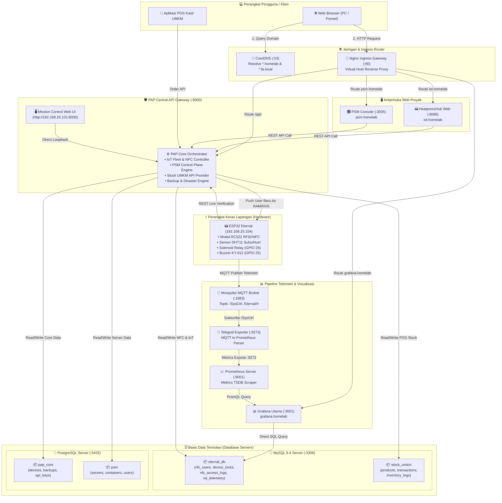
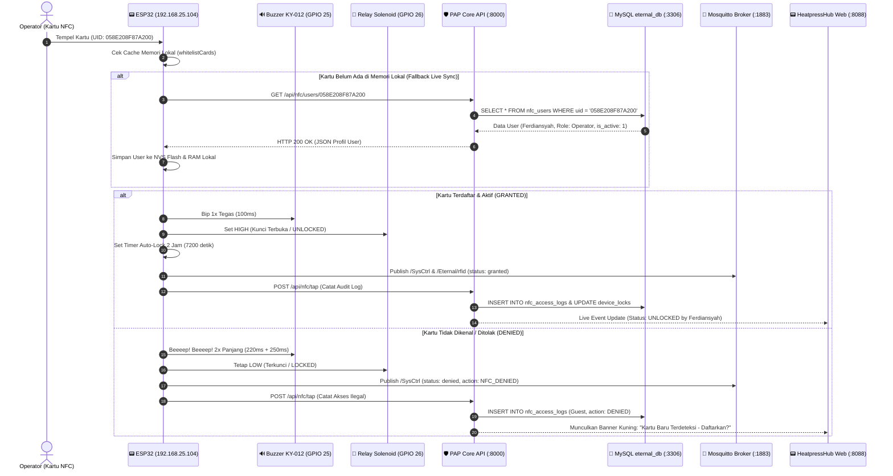
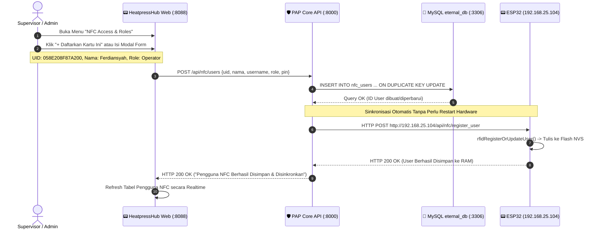
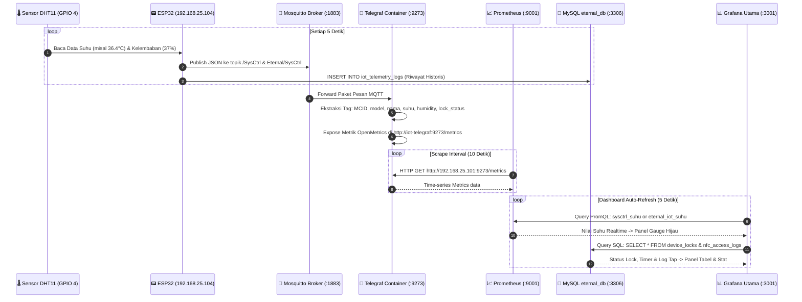
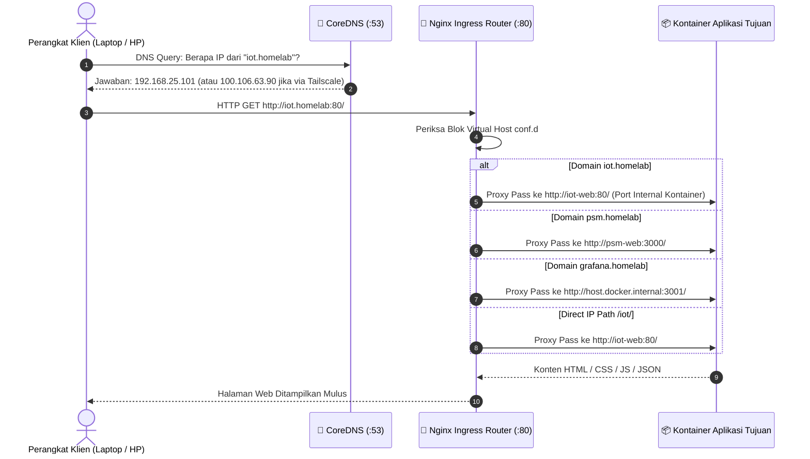
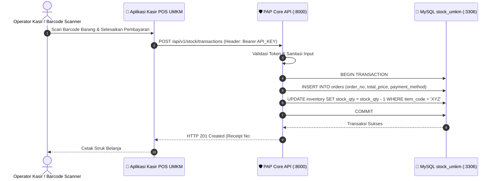
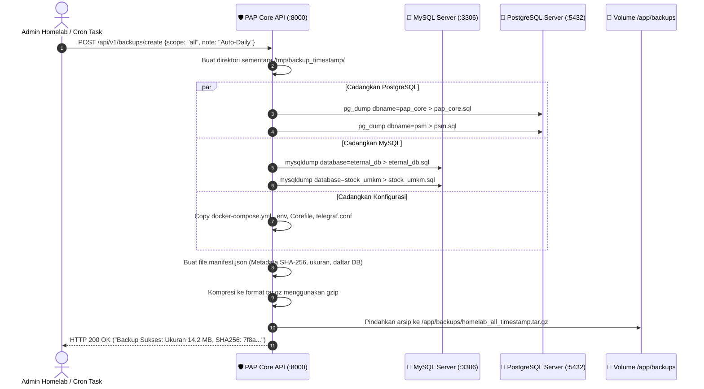

# 📘 Blueprint & Alur Komunikasi Antar-Project Homelab Server

Dokumen ini menjelaskan secara menyeluruh bagaimana seluruh modul, komponen perangkat keras (hardware), kontainer aplikasi, broker pesan, serta basis data (database) saling berkomunikasi dan bekerja sama di dalam ekosistem **Homelab Server (`fa` - 192.168.25.101 / Tailscale 100.106.63.90)**.

---

## 📑 Daftar Isi
1. [Filosofi Arsitektur & Prinsip Desain](#1-filosofi-arsitektur--prinsip-desain)
2. [Peta Topologi Seluruh Sistem (Master Map)](#2-peta-topologi-seluruh-sistem-master-map)
3. [Alur Komunikasi Mendalam (Step-by-Step Flow)](#3-alur-komunikasi-mendalam-step-by-step-flow)
   - [Flow 1: Tap Kartu NFC, Validasi Akses & Buzzer Feedback](#flow-1-tap-kartu-nfc-validasi-akses--buzzer-feedback)
   - [Flow 2: Pendaftaran User & Sinkronisasi Role dari Web ke ESP32](#flow-2-pendaftaran-user--sinkronisasi-role-dari-web-ke-esp32)
   - [Flow 3: Telemetri Sensor Suhu & Pipeline Monitoring Grafana](#flow-3-telemetri-sensor-suhu--pipeline-monitoring-grafana)
   - [Flow 4: Routing Domain Lokal (CoreDNS & Ingress Gateway)](#flow-4-routing-domain-lokal-coredns--ingress-gateway)
   - [Flow 5: Transaksi Kasir & Inventori Stock UMKM](#flow-5-transaksi-kasir--inventori-stock-umkm)
   - [Flow 6: Disaster Recovery & Engine Backup Otomatis](#flow-6-disaster-recovery--engine-backup-otomatis)
4. [Isolasi Database Mandiri (Database Partitioning)](#4-isolasi-database-mandiri-database-partitioning)
5. [Matriks Port, Jaringan & Protokol Komunikasi](#5-matriks-port-jaringan--protokol-komunikasi)
6. [Konfigurasi Hardware ESP32 & Modul KY-012](#6-konfigurasi-hardware-esp32--modul-ky-012)
7. [Panduan Diagnostik & Verifikasi Aliran Data](#7-panduan-diagnostik--verifikasi-aliran-data)

---

## 1. Filosofi Arsitektur & Prinsip Desain

Homelab server dibangun di atas tiga pilar utama:

```
┌────────────────────────────────────────────────────────────────────────┐
│                   3 PILAR UTAMA HOMELAB SERVER                         │
├──────────────────────────┬─────────────────────────┬───────────────────┤
│ 1. ONE CENTRAL GATEWAY   │ 2. DEDICATED DATABASES  │ 3. ZERO CONTAINER │
│    Semua modul backend   │ Setiap proyek memiliki  │    DUPLICATION    │
│    (IoT, PSM, Stock,     │ database mandiri, tidak │ Menggunakan MySQL │
│    Backup) disatukan ke  │ dicampur ke dalam satu  │ host, Postgres,   │
│    PAP Core (:8000)      │ database raksasa        │ Mosquitto &       │
│    tanpa duplikasi code. │ (appdb dihapus).        │ Grafana eksisting.│
└──────────────────────────┴─────────────────────────┴───────────────────┘
```

---

## 2. Peta Topologi Seluruh Sistem (Master Map)

Diagram flowchart berikut menggambarkan keterkaitan fisik dan logika antar seluruh komponen:



---

## 3. Alur Komunikasi Mendalam (Step-by-Step Flow)

### Flow 1: Tap Kartu NFC, Validasi Akses & Buzzer Feedback

Alur ini terjadi saat kartu fisik didekatkan ke modul RC522 pada ESP32:



---

### Flow 2: Pendaftaran User & Sinkronisasi Role dari Web ke ESP32

Alur sinkronisasi dua arah saat supervisor atau admin mendaftarkan kartu di Web HeatpressHub:



---

### Flow 3: Telemetri Sensor Suhu & Pipeline Monitoring Grafana

Alur pembacaan data sensor suhu/kelembaban DHT11 dari fisik hingga grafik Grafana:



---

### Flow 4: Routing Domain Lokal (CoreDNS & Ingress Gateway)

Alur resolusi domain lokal tanpa perlu mengetik nomor port yang rumit:



---

### Flow 5: Transaksi Kasir & Inventori Stock UMKM

Pemisahan basis data menjamin transaksi kasir toko tidak terganggu oleh traffic data sensor IoT:



---

### Flow 6: Disaster Recovery & Engine Backup Otomatis

Alur pencadangan data komprehensif untuk memastikan sistem aman dari kehilangan data:



---

## 4. Isolasi Database Mandiri (Database Partitioning)

Untuk memenuhi kepatuhan isolasi data, seluruh basis data dipisah secara tegas:

| Mesin Database | Nama Database | Hak Akses Pengguna | Digunakan Oleh Modul | Deskripsi Isi Tabel |
| :--- | :--- | :--- | :--- | :--- |
| **MySQL 8.4** | `eternal_db` | `appuser` / `admin12345` | Eternal IoT ESP32 & HeatpressHub | `nfc_users`, `nfc_access_logs`, `device_locks`, `iot_devices`, `iot_telemetry_logs` |
| **MySQL 8.4** | `stock_umkm` | `appuser` / `admin12345` | Aplikasi Kasir POS & Inventori UMKM | `products`, `categories`, `orders`, `stock_ledger`, `suppliers` |
| **PostgreSQL** | `pap_core` | `appuser` / `admin12345` | PAP Central API Gateway Core | `devices`, `projects`, `backups`, `api_tokens`, `system_settings` |
| **PostgreSQL** | `psm` | `appuser` / `admin12345` | Personal Server Manager | `psm_users`, `servers`, `monitored_containers`, `audit_events` |

> [!IMPORTANT]
> **Tidak ada lagi penggunaan `appdb` sebagai basis data sapu jagat**. Masing-masing aplikasi beroperasi pada ruang datanya sendiri, sehingga migrasi atau kegagalan satu modul tidak akan merusak modul lainnya.

---

## 5. Matriks Port, Jaringan & Protokol Komunikasi

| Port Host | Protokol | Komponen / Kontainer | Peran dalam Arsitektur | Klien yang Menghubungi |
| :--- | :--- | :--- | :--- | :--- |
| **`:53`** | DNS (UDP/TCP) | `homelab_dns` (CoreDNS) | Resolusi nama domain lokal | Seluruh PC/HP di jaringan LAN & Tailscale |
| **`:80`** | HTTP | `homelab_router` (Nginx) | Ingress Gateway Virtual Host | Web Browser Klien |
| **`:1883`** | MQTT (TCP) | Mosquitto (Host Daemon) | Broker pesan pub/sub telemetri | ESP32 Hardware & Telegraf |
| **`:3001`** | HTTP | Grafana Server (Host/Docker)| Visualisasi metrik & analitik | Web Browser Admin & Embed iFrame |
| **`:3005`** | HTTP | `psm-web` (Next.js) | Frontend GUI Server Manager | Web Browser Admin |
| **`:3306`** | MySQL | MySQL 8.4 Server (Host) | Penyimpanan IoT & POS Stock | PAP API, ESP32, DbGate, Grafana |
| **`:5432`** | PostgreSQL | PostgreSQL 16 (Host) | Penyimpanan Core Gateway & PSM | PAP API & PSM Engine |
| **`:8000`** | HTTP REST | `pap-api` (FastAPI) | Master Core API & Orchestrator | Web Frontend, ESP32, Script CLI |
| **`:8088`** | HTTP | `iot_dashboard_web` (Nginx) | Portal Web HeatpressHub Fleet | Web Browser Operator / Supervisor |
| **`:9001`** | HTTP | Prometheus (Docker) | Database metrik time-series | Grafana Server |
| **`:9273`** | HTTP | `iot_telegraf` | Exporter metrik MQTT | Prometheus Scraper |

---

## 6. Konfigurasi Hardware ESP32 & Modul KY-012

Hardware ESP32 Eternal menggunakan modul microcontroller LilyGo T-Display dengan tata letak pin berikut:

```
                      ESP32 ETERNAL (LilyGo T-Display)
                          ┌─────────────────────┐
                          │     ANTENNA WIFI    │
                          │   (192.168.25.104)  │
                          ├─────────────────────┤
   DHT11 Data Pin ◄───────┤ GPIO 4              │
     RC522 SS/SDA ◄───────┤ GPIO 5              │
        RC522 SCK ◄───────┤ GPIO 18             │
       RC522 MISO ◄───────┤ GPIO 19             │
       OLED I2C SDA ◄─────┤ GPIO 21             │
       OLED I2C SCL ◄─────┤ GPIO 22             │
       RC522 MOSI ◄───────┤ GPIO 23             │
   KY-012 Buzzer Signal ◄─┤ GPIO 25 (Active H)  │
   Relay Solenoid Lock ◄──┤ GPIO 26 (Active H)  │
        RC522 RST ◄───────┤ GPIO 27             │
    Tombol BOOT / Nav ◄───┤ GPIO 0              │
                          └─────────────────────┘
```

### Karakteristik Respon Nada Buzzer KY-012:
1. **Booting Sukses**: Bip 2x pendek (`80ms` & `120ms`) saat sistem siap dan terkoneksi ke WiFi.
2. **NFC Diterima (Granted)**: Bip 1x tegas (`100ms`) saat kunci terbuka atau tertutup oleh pengguna yang valid.
3. **NFC Ditolak (Denied)**: Beeep! Beeep! 2x panjang (`220ms` & `250ms`) saat kartu belum terdaftar di whitelist.

---

## 7. Panduan Diagnostik & Verifikasi Aliran Data

Jika Anda ingin memverifikasi bahwa seluruh alur di atas berjalan dengan sehat di server homelab (`fa@fa`), gunakan perintah-perintah berikut:

```bash
# 1. Audit status konektivitas seluruh layanan homelab
python3 homelab.py status

# 2. Cek status database eternal_db & tabel nfc_users
mysql -u appuser -padmin12345 -h 127.0.0.1 eternal_db -e "SELECT id, uid, nama, username, role, is_active FROM nfc_users;"

# 3. Cek live paket MQTT yang dipancarkan oleh ESP32
mosquitto_sub -h 127.0.0.1 -p 1883 -u iotuser -P 25022002 -t "/SysCtrl" -v

# 4. Tes API Gateway Core Healthcheck
curl -i http://127.0.0.1:8000/health

# 5. Uji Coba Cek User NFC langsung dari terminal
curl -i http://127.0.0.1:8000/api/nfc/users/058E208F87A200
```
