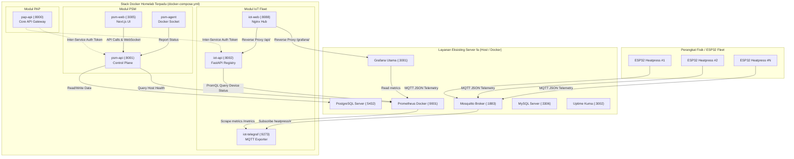

# PANDUAN PENGOPERASIAN LENGKAP HOMELAB SERVER
**Host**: `fa` (Dell OptiPlex 7050, Ubuntu 24.04.5 LTS)  
**LAN IP**: `192.168.25.101` | **Tailscale IP**: `100.106.63.90`  
**Prinsip Utama**: *Zero Duplication Architecture* (Memanfaatkan layanan eksisting di server)

---

## DAFTAR ISI
1. [Ringkasan Eksekutif & Arsitektur](#1-ringkasan-eksekutif--arsitektur)
2. [Peta Port & Alokasi Jaringan](#2-peta-port--alokasi-jaringan)
3. [Prasyarat & Persiapan Awal](#3-prasyarat--persiapan-awal)
4. [Prosedur Deployment Pertama Kali](#4-prosedur-deployment-pertama-kali)
5. [Pengoperasian Harian via CLI & Docker](#5-pengoperasian-harian-via-cli--docker)
6. [Panduan Operasional Tiap Modul](#6-panduan-operasional-tiap-modul)
   - [6.1 IoT Dashboard & Fleet Monitoring](#61-iot-dashboard--heatpress-fleet)
   - [6.2 Personal Server Manager (PSM)](#62-personal-server-manager-psm)
   - [6.3 Personal API Platform (PAP)](#63-personal-api-platform-pap)
7. [Prosedur Backup & Restore](#7-prosedur-backup--restore)
8. [Troubleshooting & Solusi Kendala](#8-troubleshooting--solusi-kendala)
9. [Checklist Verifikasi Sistem](#9-checklist-verifikasi-sistem)

---

## 1. Ringkasan Eksekutif & Arsitektur

Homelab Server ini dirancang untuk menyatukan 3 modul mandiri ke dalam satu ekosistem terpadu tanpa membebani server fisik (Dell OptiPlex 7050 dengan RAM ~4 GB).

### Prinsip Zero Duplication (Menggunakan Yang Sudah Ada)
Server `fa` sudah memiliki software infrastruktur penting yang berjalan stabil. Proyek ini **TIDAK menjalankan kontainer ganda** untuk layanan tersebut:
- **Grafana Utama (`:3001`)**: Digunakan langsung sebagai visualizer analitik armada mesin IoT.
- **Prometheus Docker (`:9001`)**: Digunakan sebagai time-series database utama untuk scraping metrik Telegraf dan monitoring PSM.
- **Mosquitto MQTT (`:1883`)**: Broker yang menerima pesan langsung dari perangkat keras (ESP32).
- **PostgreSQL (`:5432`)**: Database relasional utama server yang digunakan oleh PSM API.
- **MySQL (`:3306`)**: Database engine utama untuk aplikasi bisnis (Stock UMKM dll).

### Diagram Topologi & Alur Data



---

## 2. Peta Port & Alokasi Jaringan

### A. Layanan Eksisting Server (TIDAK DIBUATKAN CONTAINER DUPLIKAT)
| Layanan | Protokol | Port | Bind Address | Tipe / Provider | Keterangan |
| :--- | :--- | :--- | :--- | :--- | :--- |
| **Mosquitto** | TCP | `1883` | `0.0.0.0:1883` | Host Docker (`pid 5113`) | Broker IoT utama |
| **Grafana** | HTTP | `3001` | `192.168.25.101:3001` | Host Docker (`pid 4859`) | Dashboard visualisasi |
| **Prometheus**| HTTP | `9001` | `*:9001` | Host Docker (`pid 1737`) | Server TSDB metrics |
| **PostgreSQL**| TCP | `5432` | `192.168.25.101:5432` | Host Docker (`pid 5206`) | Database utama |
| **MySQL** | TCP | `3306` | `192.168.25.101:3306` | Host Docker (`pid 4659`) | Database UMKM & inventory |
| **Uptime Kuma**| HTTP | `3002` | `192.168.25.101:3002` | Host Docker (`pid 4516`) | Health monitoring |
| **Vaultwarden**| HTTP | `8080` | `0.0.0.0:8080` | Host Docker (`pid 32500`) | Password manager |
| **Apache** | HTTP | `8081` | `*:8081` | Host Service (`pid 15082`) | Web server statis |
| **Cockpit** | HTTPS | `9090` | `*:9090` | Host Service (`pid 5321`) | Server management Linux |
| **MicroK8s** | HTTPS | `16443` | `*:16443` | Snap Service (`pid 4123673`)| Kubernetes cluster |

### B. Kontainer Aplikasi Master Stack
| Nama Container | Port Host | Port Kontainer | Jaringan Internal | Keterangan |
| :--- | :--- | :--- | :--- | :--- |
| **`pap-api`** | `192.168.25.101:8000` | `8000` | `homelab-network` | Personal API Platform Gateway |
| **`psm-api`** | `0.0.0.0:8001` | `8000` | `homelab-network`, `psm-network` | Personal Server Manager Backend |
| **`psm-web`** | `0.0.0.0:3005` | `3005` | `psm-network` | Personal Server Manager Web (Next.js) |
| **`psm-agent`** | - | - | `psm-network` | Docker Host Agent Controller |
| **`iot_telegraf`** | `0.0.0.0:9273` | `9273` | `iot-network` | MQTT to Prometheus Exporter |
| **`iot_device_mapping_api`** | `0.0.0.0:8002` | `8000` | `homelab-network`, `iot-network` | Device Registry & Status Engine |
| **`iot_dashboard_web`** | `0.0.0.0:8088` | `80` | `iot-network` | Nginx Hub & Reverse Proxy |

---

## 3. Prasyarat & Persiapan Awal

### Kebutuhan Perangkat Lunak di Server `fa`
1. **Docker Engine**: Versi 24.0+ dengan plugin Docker Compose v2 (`docker compose version`).
2. **Python**: Versi 3.10 atau lebih tinggi (`python3 --version`).
3. **Docker Prometheus & Grafana**: Service monitoring utama yang sudah berjalan di Docker host.
4. **Hak Akses Sudo**: Diperlukan untuk restart container atau mengelola network socket.

### Struktur Direktori Server `/opt` (Aktual di Server `fa`)

```text
/opt/
├── dockge/                          <- Dockge Stack & Container Manager UI
│   ├── compose.yaml
│   └── data/ (dockge.db)
├── homelab/                         <- Layanan Infrastruktur Eksisting (Docker Stacks)
│   ├── databases/                   <- Database Engine (PostgreSQL :5432 & MySQL :3306)
│   │   ├── compose.yaml
│   │   └── docker-compose.yaml
│   ├── grafana/                     <- Grafana Utama (:3001)
│   │   └── compose.yaml
│   ├── mosquitto/                   <- Mosquitto MQTT Broker (:1883)
│   │   ├── compose.yaml
│   │   ├── config/ (mosquitto.conf, passwordfile)
│   │   └── data/ (mosquitto.db)
│   ├── prometheus/                  <- Prometheus Docker (:9001)
│   │   ├── config/
│   │   │   └── prometheus.yml       <- File konfigurasi scrape target
│   │   ├── data/ (TSDB chunks, wal)
│   │   └── docker-compose.yml
│   └── uptime-kuma/                 <- Uptime Kuma Health Hub (:3002)
│       └── compose.yaml
└── projects/
    └── homelab-server/              <- REPOSITORY PROYEK KITA (Master Stack)
        ├── dashboard_iot/           <- Modul Heatpress IoT Monitoring
        ├── data/
        │   └── mapping.db           <- Database SQLite registrasi perangkat
        ├── Personal Api Platform/   <- Modul PAP (Central API Gateway :8000)
        ├── Personal_Server_Manager/ <- Modul PSM (API :8001, Web :3005, Agent)
        ├── docker-compose.yml       <- Master Docker Compose terpadu
        ├── homelab.py               <- CLI Manajemen Terpadu Homelab
        ├── deploy.sh                <- Skrip Deployment Otomatis Server
        ├── .env                     <- File environment aktif
        ├── .env.example             <- Template environment
        ├── port.md                  <- Audit port aktual server fa
        ├── README.md                <- Ringkasan proyek
        └── PANDUAN_OPERASIONAL.md   <- Dokumen panduan ini
```

---

## 4. Prosedur Deployment di Server `fa`

Deployment dapat dilakukan dengan dua cara: **Metode A (Otomatis)** menggunakan script `deploy.sh` atau **Metode B (Manual)** jika ingin mengeksekusi langkah per langkah.

---

### METODE A: Deployment Otomatis via `deploy.sh` (SANGAT DIREKOMENDASIKAN)

Script [`deploy.sh`](file:///d:/repository/homelab-server/deploy.sh) dirancang khusus untuk struktur `/opt` di server `fa`. Script ini secara otomatis memeriksa dependensi, memperbarui scrape config Prometheus eksisting di `/opt/homelab/prometheus/config/prometheus.yml`, menyiapkan database `psm`, memvalidasi `.env`, mem-build dan menjalankan seluruh kontainer, serta mengimpor dashboard ke Grafana.

Cukup jalankan satu baris perintah berikut di server `fa`:

```bash
cd /opt/projects/homelab-server
chmod +x deploy.sh
./deploy.sh
```

#### Apa saja yang dilakukan `deploy.sh` secara otomatis?
1. **Validasi Prasyarat**: Memastikan Docker, Docker Compose v2, Python 3, dan Curl tersedia.
2. **Audit Layanan Eksisting**: Memeriksa `/opt/homelab/databases`, `/opt/homelab/mosquitto`, `/opt/homelab/grafana`, dan `/opt/homelab/prometheus`.
3. **Konfigurasi Prometheus Otomatis**: Memeriksa `/opt/homelab/prometheus/config/prometheus.yml`. Jika job `iot_heatpress` belum ada, script membuat backup dan otomatis menambahkan target scrape Telegraf (`192.168.25.101:9273`), lalu me-reload Prometheus via HTTP API atau `docker compose restart`.
4. **Setup Database PostgreSQL**: Memeriksa dan membuat database `psm` di server PostgreSQL host jika belum tersedia.
5. **Setup Environment**: Menyiapkan file `.env` dari `.env.example` dan menyinkronkan file SQLite `data/mapping.db` dengan `dashboard_iot/api/data/mapping.db`.
6. **Orkestrasi Docker**: Menjalankan `docker compose config`, membangun image, dan mengeksekusi `docker compose up -d --remove-orphans`.
7. **Healthcheck Loop**: Menunggu dan memvalidasi ke-6 endpoint layanan hingga semuanya berstatus `[ONLINE]`.
8. **Impor Grafana Interaktif**: Menawarkan opsi otomatis untuk langsung mengimpor 4 dashboard Heatpress ke Grafana `:3001` menggunakan API Token atau login admin.

---

### METODE B: Prosedur Deployment Manual (Langkah demi Langkah)

Jika Anda ingin menjalankan proses secara manual tanpa script `deploy.sh`:

#### Langkah 1: Siapkan Konfigurasi Lingkungan (`.env`)
Salin file template `.env.example` ke `.env` di `/opt/projects/homelab-server`:
```bash
cd /opt/projects/homelab-server
cp .env.example .env
```
Pastikan variabel utama di dalam `.env` sudah benar:
- `HOST_IP=192.168.25.101`
- `HOST_TAILSCALE=100.106.63.90`
- `POSTGRES_HOST=192.168.25.101`
- `POSTGRES_PORT=5432`
- `POSTGRES_USER=appuser`
- `POSTGRES_PASSWORD=admin12345`
- `PROMETHEUS_URL=http://host.docker.internal:9001`
- `EXISTING_GRAFANA_URL=http://192.168.25.101:3001`

#### Langkah 2: Buat Database PostgreSQL untuk PSM
Pastikan database `psm` sudah dibuat di PostgreSQL host:
```bash
# Eksekusi via psql di server host:
PGPASSWORD="admin12345" psql -h 192.168.25.101 -p 5432 -U appuser -d postgres -c "CREATE DATABASE psm;"
```

#### Langkah 3: Konfigurasikan Prometheus Docker untuk Scrape Telegraf
Buka file konfigurasi `prometheus.yml` di `/opt/homelab/prometheus/config/prometheus.yml`:
```bash
sudo nano /opt/homelab/prometheus/config/prometheus.yml
```
Tambahkan job `iot_heatpress` di bawah blok `scrape_configs`:
```yaml
scrape_configs:
  - job_name: 'iot_heatpress'
    scrape_interval: 5s
    scrape_timeout: 4s
    static_configs:
      - targets: ['192.168.25.101:9273']
        labels:
          environment: 'homelab'
          service: 'heatpress_iot'
```
Simpan file (`Ctrl+O`, `Enter`, `Ctrl+X`), lalu reload atau restart Prometheus:
```bash
# Opsi A: Reload via HTTP (jika flag lifecycle aktif):
curl -X POST http://192.168.25.101:9001/-/reload

# Opsi B: Restart container Prometheus Docker:
cd /opt/homelab/prometheus && docker compose restart
```
Verifikasi target aktif di browser: `http://192.168.25.101:9001/targets` (akan berstatus UP setelah Telegraf dijalankan).

#### Langkah 4: Build dan Jalankan Master Stack
```bash
cd /opt/projects/homelab-server
docker compose up -d --build
```
Periksa kontainer yang sedang berjalan:
```bash
docker compose ps
```
Pastikan 7 kontainer (`pap-api`, `psm-api`, `psm-web`, `psm-agent`, `iot-telegraf`, `iot-api`, `iot-web`) berstatus `Up (healthy)`.

#### Langkah 5: Impor Dashboard ke Grafana Eksisting (:3001)
1. Buka Grafana di browser: `http://192.168.25.101:3001`
2. Masuk ke **Administration** → **Users and access** → **Service Accounts** (atau API Keys).
3. Buat Service Account baru dengan role **Admin** / **Editor**, lalu salin Token yang dihasilkan.
4. Jalankan script import otomatis:
```bash
python3 homelab.py import-grafana --host 192.168.25.101 --port 3001 --token <TOKEN_GRAFANA_ANDA>
```
Script ini otomatis membuat folder **`Heatpress Fleet Monitoring`** dan mengimpor 4 dashboard analitik.
```
Script ini akan:
- Membuat folder baru di Grafana: **`Heatpress Fleet Monitoring`**
- Mengimpor 4 dashboard analitik heatpress secara otomatis:
  1. *Heatpress Executive Overview* (ID: `heatpress-overview`)
  2. *Heatpress Machine Deep Dive* (ID: `heatpress-deep-dive`)
  3. *Heatpress Energy & Cost Tracker* (ID: `heatpress-energy-cost`)
  4. *Heatpress System Diagnostics* (ID: `heatpress-diagnostics`)

---

## 5. Pengoperasian Harian via CLI & Docker

Repository menyediakan script utilitas CLI terpadu: [`homelab.py`](file:///d:/repository/homelab-server/homelab.py).

### Perintah CLI `homelab.py`

| Perintah | Deskripsi Fungsi |
| :--- | :--- |
| `python homelab.py status` | Audit port dan cek status online/offline seluruh layanan host & container. |
| `python homelab.py up` | Menjalankan seluruh kontainer homelab di background (`docker compose up -d`). |
| `python homelab.py down` | Menghentikan seluruh kontainer aplikasi homelab dengan aman. |
| `python homelab.py restart` | Me-restart seluruh kontainer aplikasi homelab. |
| `python homelab.py build` | Melakukan build ulang seluruh image container tanpa cache. |
| `python homelab.py logs [service]`| Menampilkan log kontainer realtime (misal: `python homelab.py logs iot-api`). |
| `python homelab.py import-grafana`| Mengimpor atau memperbarui dashboard IoT di Grafana eksisting (:3001). |

### Perintah Docker Standar yang Sering Digunakan

```bash
# Melihat log gabungan secara realtime:
docker compose logs -f

# Melihat log spesifik modul tertentu:
docker compose logs -f iot-api
docker compose logs -f psm-api
docker compose logs -f pap-api

# Me-restart modul tertentu tanpa mengganggu modul lain:
docker compose restart iot-api
docker compose restart iot-web

# Masuk ke terminal di dalam kontainer:
docker compose exec psm-api bash
docker compose exec iot-api sh

# Memeriksa penggunaan resource RAM & CPU tiap container:
docker stats --no-stream
```

---

## 6. Panduan Operasional Tiap Modul

### 6.1 IoT Dashboard & Heatpress Fleet

#### A. Alamat Akses Antarmuka
- **Web Hub Fleet Dashboard**: `http://192.168.25.101:8088/`
- **Device Management REST API**: `http://192.168.25.101:8002/docs`
- **Telegraf Prometheus Metrics Exporter**: `http://192.168.25.101:9273/metrics`

#### B. Cara Menambahkan & Mendaftarkan Mesin Baru (ESP32)
1. **Flash Firmware ESP32**:
   - Pastikan ESP32 terhubung ke WiFi lokal.
   - Arahkan MQTT Broker ke `192.168.25.101:1883`.
   - Publish data telemetry ke topik: `heatpress/<MAC_ADDRESS>/telemetry` atau `heatpress/<MCID>/telemetry`.
2. **Format Payload JSON Standar Telemetri**:
   ```json
   {
     "mcid": "HPM-01",
     "mac": "24:6F:28:AB:CD:EF",
     "temp_top": 185.5,
     "temp_bottom": 180.2,
     "target_temp": 185.0,
     "voltage": 220.4,
     "current": 8.5,
     "power": 1873.4,
     "press_count": 1420,
     "status": "RUNNING",
     "heating": true,
     "pressing": false
   }
   ```
3. **Mendaftarkan Mapping di Web Dashboard**:
   - Buka `http://192.168.25.101:8088/`
   - Klik menu **"Device Mapping"**
   - Tambahkan data baru: MAC Address, Machine ID (contoh: `HPM-05`), Tipe Model (`Pneumatic 40x60`), dan Lokasi (`Lantai 1 - Sablon A`).
   - Simpan. Sistem otomatis memetakan identitas mesin di Prometheus dan Grafana.

---

### 6.2 Personal Server Manager (PSM)

#### A. Alamat Akses Antarmuka
- **PSM Web Dashboard (Next.js)**: `http://192.168.25.101:3005/`
- **PSM Control Plane API**: `http://192.168.25.101:8001/`
- **PSM Swagger API Docs**: `http://192.168.25.101:8001/docs`

#### B. Fitur & Penggunaan
- **Server Health**: Memantau beban CPU, RAM, disk host secara langsung via Prometheus host (`:9001`) dan `psm-agent`.
- **Docker Management**: Mengawasi status kontainer yang sedang berjalan di Docker engine host melalui mounted socket `/var/run/docker.sock`.
- **Deployments & Release Storage**: File rilis dan upload tersimpan secara persisten pada volume Docker `psm-storage` (terletak di `/opt/psm` dalam container).

---

### 6.3 Personal API Platform (PAP)

#### A. Alamat Akses Antarmuka
- **API Base URL**: `http://192.168.25.101:8000/`
- **Health Check**: `http://192.168.25.101:8000/health`
- **OpenAPI / Swagger Docs**: `http://192.168.25.101:8000/docs`

#### B. Integrasi Antar-Layanan
PAP bertindak sebagai API gateway dan penyedia token integrasi bersama. Kunci API default untuk inter-service communication dapat dikonfigurasi pada file `.env` (`PAP_API_KEY`).

---

## 7. Prosedur Backup & Restore

### A. Komponen yang Perlu Dibackup

1. **Database SQLite IoT Mapping**:
   - Lokasi: `/opt/projects/homelab-server/data/mapping.db` & `/opt/projects/homelab-server/dashboard_iot/api/data/mapping.db`
   - File ini menyimpan seluruh relasi MAC Address ↔ Nama Mesin ↔ Lokasi.
2. **Database PostgreSQL Host (PSM & App Data)**:
   - Database: `psm`
3. **Volume Persisten PSM**:
   - Volume: `homelab-server_psm-storage` (atau `psm-storage`)
4. **File Konfigurasi**:
   - File `/opt/projects/homelab-server/.env` dan `/opt/homelab/prometheus/config/prometheus.yml`.

### B. Perintah Backup Otomatis (Bash Script)

```bash
#!/bin/bash
BACKUP_DIR="/home/fa/backups/homelab_$(date +%Y%m%d_%H%M%S)"
mkdir -p "$BACKUP_DIR"

echo "[1/4] Backup SQLite IoT Registry (mapping.db)..."
cp /opt/projects/homelab-server/data/mapping.db "$BACKUP_DIR/mapping.db" || cp /opt/projects/homelab-server/dashboard_iot/api/data/mapping.db "$BACKUP_DIR/mapping.db"

echo "[2/4] Backup Database PostgreSQL Host (psm)..."
PGPASSWORD="admin12345" pg_dump -h 192.168.25.101 -U appuser -d psm -F c -b -v -f "$BACKUP_DIR/psm_database.dump"

echo "[3/4] Backup File Environment & Prometheus Config..."
cp /opt/projects/homelab-server/.env "$BACKUP_DIR/.env.backup"
cp /opt/homelab/prometheus/config/prometheus.yml "$BACKUP_DIR/prometheus.yml.backup"

echo "[4/4] Backup Volume Storage PSM..."
docker run --rm -v homelab-server_psm-storage:/data -v "$BACKUP_DIR":/backup alpine tar czf /backup/psm_storage.tar.gz -C /data .

echo "Backup berhasil disimpan di: $BACKUP_DIR"
```

### C. Prosedur Pemulihan (Restore)

```bash
# 1. Restore SQLite IoT Registry:
cp /path/to/backup/mapping.db /opt/projects/homelab-server/data/mapping.db
cp /path/to/backup/mapping.db /opt/projects/homelab-server/dashboard_iot/api/data/mapping.db

# 2. Restore PostgreSQL Database:
PGPASSWORD="admin12345" pg_restore -h 192.168.25.101 -U appuser -d psm --clean --if-exists /path/to/backup/psm_database.dump

# 3. Restore Volume Storage PSM:
docker run --rm -v homelab-server_psm-storage:/data -v /path/to/backup:/backup alpine tar xzf /backup/psm_storage.tar.gz -C /data
```

---

## 8. Troubleshooting & Solusi Kendala

### Kendala 1: Port Bentrok (`bind: address already in use`)
* **Penyebab**: Ada proses lain yang berjalan di host pada port yang sama.
* **Diagnosa**:
  ```bash
  sudo ss -lntp | grep <PORT>
  ```
* **Solusi**:
  - Jika port `8080` bentrok: Port `8080` digunakan oleh Vaultwarden. Pastikan tidak ada aplikasi homelab yang menggunakan port `8080`.
  - Jika port `8081` bentrok: Port `8081` digunakan oleh Apache `httpd`. IoT Web Hub kita pasang di port `8088`.
  - Jika port `3001` bentrok: Port `3001` adalah Grafana utama. Master compose tidak mem-binding port `3001` melainkan menggunakan `extra_hosts: host.docker.internal:host-gateway`.

---

### Kendala 2: Grafana Menolak Tampilan Iframe di Dashboard IoT Web Hub
* **Gejala**: Halaman web hub IoT di `http://192.168.25.101:8088/` menampilkan pesan error *"Refused to display 'http://192.168.25.101:3001/' in a frame because it set 'X-Frame-Options' to 'deny'"*.
* **Solusi**:
  Aktifkan opsi embedding di konfigurasi Grafana host (`/etc/grafana/grafana.ini` atau environment container Grafana host):
  ```ini
  [security]
  allow_embedding = true
  cookie_samesite = disabled

  [auth.anonymous]
  enabled = true
  org_role = Viewer
  ```
  Lalu restart Grafana:
  ```bash
  docker restart <container_id_grafana>
  # atau
  sudo systemctl restart grafana-server
  ```

---

### Kendala 3: Telegraf Tidak Mengirim Metrik ke Prometheus (Target DOWN)
* **Gejala**: Di `http://192.168.25.101:9001/targets`, status `iot_heatpress` adalah `DOWN` atau `Connection refused`.
* **Solusi**:
  1. Periksa apakah kontainer `iot_telegraf` berjalan normal:
     ```bash
     docker compose ps iot-telegraf
     docker compose logs iot-telegraf
     ```
  2. Tes endpoint metrik dari host:
     ```bash
     curl -i http://127.0.0.1:9273/metrics
     ```
  3. Pastikan port `9273` terbuka di firewall host (`sudo ufw status`).

---

### Kendala 4: Telegraf Gagal Terhubung ke Broker Mosquitto
* **Gejala**: Log `iot-telegraf` menampilkan pesan `[inputs.mqtt_consumer] Error in plugin: network Error : dial tcp 192.168.25.101:1883: connect: connection refused`.
* **Solusi**:
  1. Pastikan Mosquitto di host mengizinkan koneksi dari subnet bridge Docker (`172.16.0.0/12`):
     Di file konfigurasi Mosquitto (`/etc/mosquitto/mosquitto.conf` atau mount volume mosquitto):
     ```conf
     listener 1883 0.0.0.0
     allow_anonymous false
     password_file /mosquitto/config/password.txt
     ```
  2. Periksa kredensial MQTT di `.env`:
     `MQTT_USERNAME=useriot`
     `MQTT_PASSWORD=25022002`

---

### Kendala 5: PSM API Gagal Konek ke PostgreSQL (`password authentication failed` atau `database does not exist`)
* **Gejala**: Log `psm-api` menampilkan `psycopg2.OperationalError: database "psm" does not exist`.
* **Solusi**:
  Buat database `psm` di PostgreSQL host server:
  ```bash
  sudo -u postgres psql -c "CREATE DATABASE psm OWNER appuser;"
  sudo -u postgres psql -c "GRANT ALL PRIVILEGES ON DATABASE psm TO appuser;"
  ```
  Restart PSM API:
  ```bash
  docker compose restart psm-api
  ```

---

### Kendala 6: RAM Server Menipis / Kontainer Kena OOM Killer
* **Penyebab**: Server memiliki RAM ~4 GB yang digunakan bersama dengan MicroK8s, PostgreSQL, MySQL, Apache, dan Docker.
* **Solusi**:
  Master compose sudah dilengkapi pembatasan resource (`mem_limit` dan `cpus`):
  - `pap-api`: Maksimal 256 MB RAM, 0.5 CPU.
  - Jika MicroK8s tidak sedang digunakan secara aktif dan memakan RAM besar, Anda dapat menghentikannya sementara:
    ```bash
    microk8s stop
    ```

---

## 9. Checklist Verifikasi Sistem

Gunakan checklist ini setelah melakukan instalasi, restart server, atau update kode:

| No | Komponen yang Diperiksa | Perintah / URL Verifikasi | Ekspektasi Hasil | Status |
| :-: | :--- | :--- | :--- | :-: |
| 1 | **Status Port Host** | `python homelab.py status` | Semua port eksisting & app berstatus `[ONLINE]` | [ ] |
| 2 | **Kesehatan Docker Stack** | `docker compose ps` | 7 kontainer berstatus `healthy` | [ ] |
| 3 | **Scrape Target Prometheus** | `curl -s http://192.168.25.101:9001/api/v1/targets \| grep iot_heatpress` | `"health":"up"` | [ ] |
| 4 | **Grafana Dashboard** | Buka `http://192.168.25.101:3001` | Folder *Heatpress Fleet Monitoring* berisi 4 dashboard | [ ] |
| 5 | **IoT Web Hub** | Buka `http://192.168.25.101:8088/` | Tampilan Web Hub Heatpress & iframe Grafana aktif | [ ] |
| 6 | **IoT Device API** | `curl -s http://192.168.25.101:8002/health` | `{"status":"ok","database":"connected"}` | [ ] |
| 7 | **PSM Control Plane** | `curl -s http://192.168.25.101:8001/health` | `{"status":"ok"}` | [ ] |
| 8 | **PSM Web Frontend** | Buka `http://192.168.25.101:3005/` | Dashboard PSM dapat diakses di browser | [ ] |
| 9 | **PAP Gateway API** | `curl -s http://192.168.25.101:8000/health` | `{"status":"ok"}` | [ ] |
| 10| **Koneksi MQTT Broker** | `mosquitto_sub -h 192.168.25.101 -p 1883 -u useriot -P 25022002 -t "heatpress/#" -C 1` | Payload JSON terbaca | [ ] |

---
*Dokumen ini diperbarui secara berkala mengikuti arsitektur aktif Homelab Server `fa`.*

